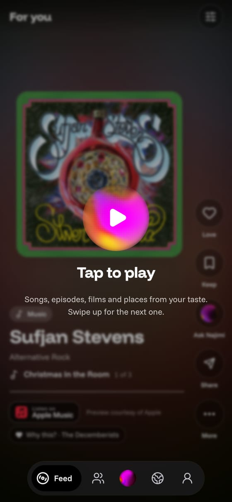
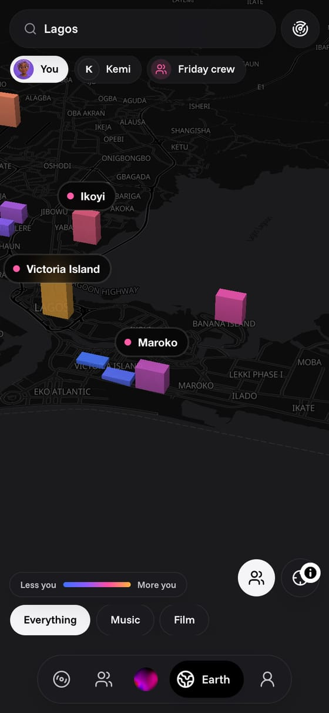
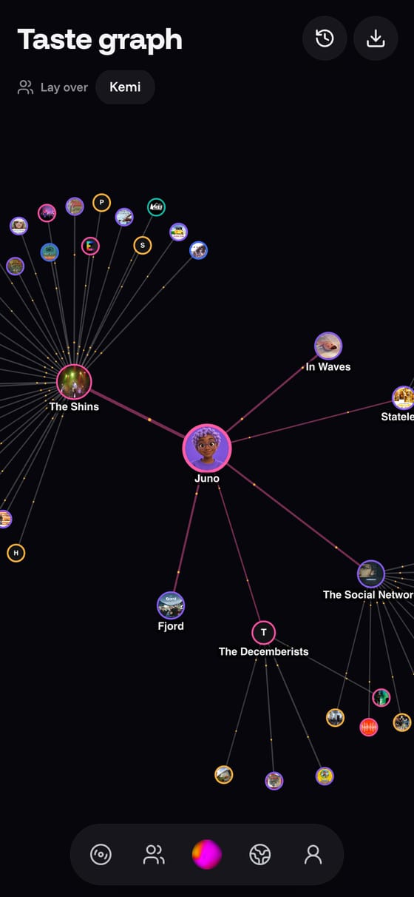
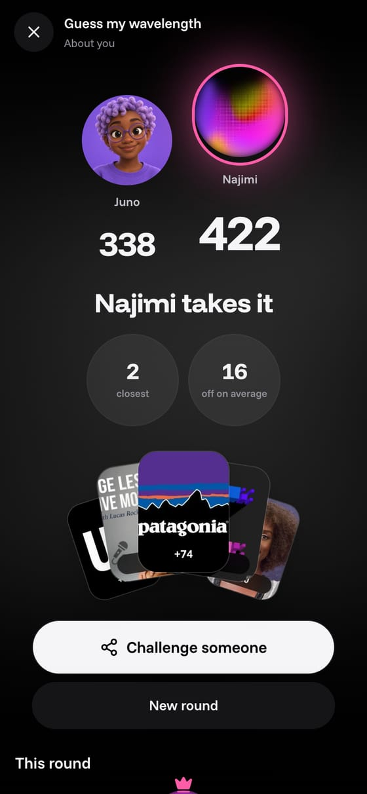
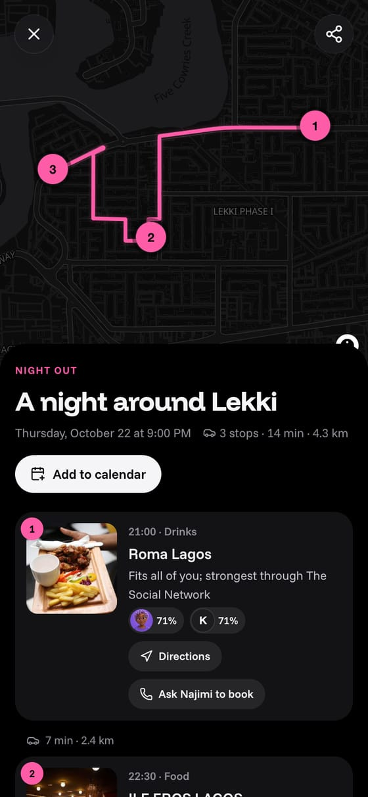
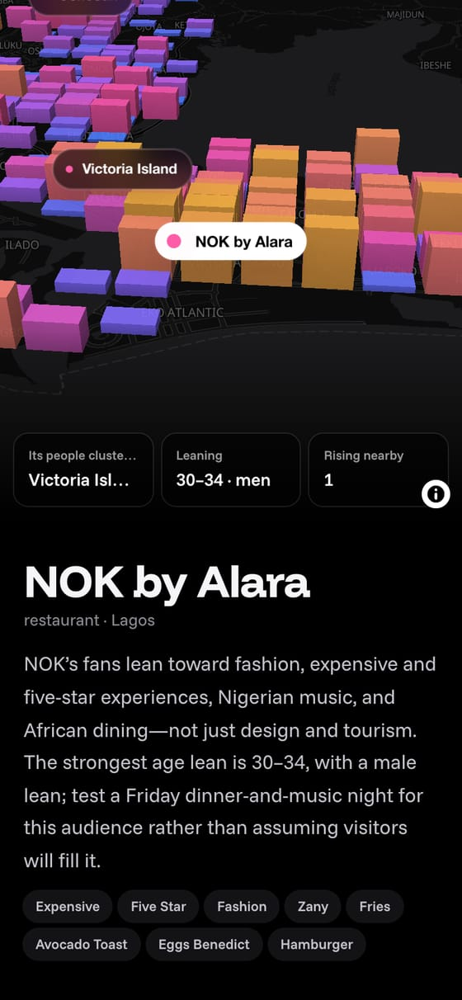

<p align="center">
  
</p>

<p align="center">
  <a href="https://najimi.xyz"><b>Open Najimi</b></a>
  &nbsp;·&nbsp;
  <a href="https://docs.najimi.xyz"><b>Documentation</b></a>
  &nbsp;·&nbsp;
  <a href="https://docs.najimi.xyz/docs/qloo"><b>How it uses Qloo</b></a>
</p>

<p align="center">
  Built on&nbsp;
  <a href="https://www.qloo.com">
    <picture>
      <source media="(prefers-color-scheme: dark)" srcset=".github/assets/qloo-light.svg">
      
    </picture>
  </a>
</p>

**Najimi is a social app where your taste is your identity.** Tell it a few things you love, or let it read what you already follow, and Qloo's taste graph turns that into a taste that reaches music, film, TV, books, podcasts, brands, places, destinations and people. Najimi plays it back as a feed, shows where your people are on a globe, lets you play it with friends, plans nights and trips around it, and puts an AI agent in every chat that can act on it.

Built for the **[Qloo Agentic Hackathon](https://qloo.devpost.com/)**. *Najimi* (馴染み) means **someone you know well**.

<table>
  <tr>
    <td></td>
    <td></td>
    <td></td>
  </tr>
  <tr>
    <td align="center"><b>Feed</b><br>Your taste, played: previews, trailers, places, each with its <i>because</i>.</td>
    <td align="center"><b>Earth</b><br>Where your taste lives, square by square. Tap one for its scene.</td>
    <td align="center"><b>Graph</b><br>Pull a love's weight and watch everything re-rank.</td>
  </tr>
  <tr>
    <td></td>
    <td></td>
    <td></td>
  </tr>
  <tr>
    <td align="center"><b>Games</b><br>Qloo knows the answers; Najimi plays too.</td>
    <td align="center"><b>Plans</b><br>A night or a trip, routed, with each person's fit.</td>
    <td align="center"><b>Business</b><br>Who your people are, where they cluster, what to try.</td>
  </tr>
</table>

## What it does

- **Your taste in a minute.** Pick three loves (real Qloo artwork as you type), or bring a Letterboxd, Last.fm or Goodreads name, or X and Instagram handles. Qloo builds picks in ten kinds, your taste words and the neighbourhoods where your people cluster, live.
- **Feed.** Full-screen cards with 30-second Apple previews, trailers, podcast episodes, books and places. Love or skip, tune the mix like a mixing desk, and one player follows you round the app (lock screen included).
- **People and circles.** Search by username, see your match with anyone, find your taste twins, and make circles: group chats with Najimi in them.
- **Games.** *Guess my wavelength*, *How well do you know me*, *Taste twins* and *Blind Taste*, with a daily drop per circle, a weekly leaderboard, and challenge links that work without an account.
- **Earth.** A globe of where your taste (or a friend's, or a circle's) lives. Tap a square for its scene; the radar shows the people whose taste matches yours (for those who turned it on).
- **Graph.** Your taste as a web: drag a love's weight, grow any node, lay a friend's taste over yours, slide back through your history.
- **Your feeds.** One platform at a time (X, Instagram, TikTok, YouTube): a score for how much of your For You page is really you, today's accounts to follow and the topics to teach it, and **Do it for me**, where Najimi follows them for you each morning, slowly.
- **Plans and booking.** "9pm in Lekki" or "Lisbon for three days": stops in order with the real route, each person's fit, shows that night, *Add to calendar*. The day after, Najimi asks how it was.
- **Business mode.** "I run a café in Yaba": Najimi reads your site, finds you in Qloo (or places like you) and builds a plan you can share, rebuilt every Monday.
- **Passport and Wrapped.** A year of stamps, how your taste moved, and five story slides that share straight to Instagram.
- **An app on your phone.** Installable, with push for circle messages, games and plans; who sees your taste, blocking and reporting, and *Delete all my data*.

## The agent

Najimi is a member of every chat. It knows your taste, everyone else's in the room, the screen you opened it from, your plans and your connected accounts, and it has Qloo's whole surface as tools (`qlooSearch`, `qlooInsights`, `qlooTags`, `qlooCompare`, `qlooAudiences`) beside `groupFit`, `steerFeed`, `startGame`, `planNight`, `planTrip`, `findHotels`, `callToBook`, `businessPlan`, `postToX` and `makeImage`. Each step shows in the chat as it runs. Anything that acts in your name (a call, a post, a booking) waits for your yes, and every recommendation stands on a Qloo result.

Hotel booking (Nuitee, paid in Nuitee's own sheet) and table calls (an ElevenLabs voice agent over Twilio) are wired end to end; they switch on in production when their live keys are added.

## How Najimi uses Qloo

Everything above is a Qloo answer, seen a different way.

| Qloo | Where |
| --- | --- |
| `POST /v2/insights` with weighted loves and **explainability** | Your picks in ten kinds; the **because** chip and *Made of your loves* on every pick; the feed's next pages |
| `urn:tag` insights | Your taste words |
| `urn:heatmap` | Earth, trip areas, where a business's people cluster |
| `signal.location` with no person | A square's scene: its artists, brands, places, words |
| `filter.results.entities` | Game answers, group fit per person, feed scores |
| `/v2/analysis/compare` | Your match with anyone; a business against its street |
| `urn:demographics`, `audience_growth` | A business's lean, and what's rising nearby |
| `/search`, `/entities`, `/v2/tags`, `/v2/audiences` | Names to ids, imports by handle, tags by meaning, audiences |

Every call is logged and cached (Postgres, keyed by path, parameters and body), and the Qloo chip on any card opens the exact request behind it. The full map is on the [Qloo page of the docs](https://docs.najimi.xyz/docs/qloo).

## Architecture

A pnpm and Turborepo monorepo, every piece a container on one Coolify server.

| Path | What |
| --- | --- |
| [`apps/web`](apps/web) | Next.js 16: pages, API routes, cards, the landing, link previews and story slides (`next/og`) |
| [`apps/worker`](apps/worker) | pg-boss: agent turns, taste reveals, business plans, *Do it for me*, bookings, follow-ups, the push sender; runs migrations |
| [`apps/social-bridge`](apps/social-bridge) | Python FastAPI, internal only: Instagram through instagrapi |
| [`apps/docs`](apps/docs) | The documentation (Fumadocs) |
| [`packages/qloo`](packages/qloo) | The Qloo client: cache, concurrency limit, retries, call log, taste and explore helpers |
| [`packages/agent`](packages/agent) | Rules, tools, turns, business plans |
| [`packages/booking`](packages/booking) | Plans, routes, shows, Nuitee, phone calls, calendar files |
| [`packages/connectors`](packages/connectors) | Imports, the daily tune-up, X (rettiwt-api), sealed sessions, the bridge client |
| [`packages/games`](packages/games), [`geo`](packages/geo), [`db`](packages/db), [`live`](packages/live), [`jobs`](packages/jobs), [`sources`](packages/sources) | Rounds and scoring; geohash squares; Drizzle schema and migrations; the live pipe; queues; outside fetching and caching |

Every chat is a room. A message is saved and announced on the room's live topic; if it calls Najimi, the worker runs the turn and streams it to everyone in the room. One Postgres `LISTEN/NOTIFY` channel carries every live event to pages over server-sent events, and to phones as Web Push. More on the [architecture page](https://docs.najimi.xyz/docs/build).

## Run it locally

You need Node 22.18 or later, pnpm 11 and Docker.

```bash
cp .env.example .env    # QLOO_API_KEY and OPENAI_API_KEY at least
pnpm install
pnpm services:up        # Postgres and RustFS
pnpm dev                # web on :3310, docs on :3311, the worker (migrates on start)
```

`pnpm run ci` runs the linter, type checks and production builds.

## Provenance

- **Qloo** data comes from the hackathon API (`hackathon.api.qloo.com`); entity artwork is Qloo's. The Qloo wordmark is Qloo's own, used to credit it. No Qloo data is stored in this repository.
- **Music previews** are Apple's (30 seconds, courtesy of Apple, each linking to Apple Music); **trailers** come from TMDB and play on YouTube; **podcasts** play from each show's own feed; **book covers** from Open Library.
- **Places and routes**: OpenStreetMap (© OpenStreetMap contributors) through Nominatim, Mapbox Directions, MapLibre GL JS; **shows**: Ticketmaster; **social accounts**: Wikidata.
- **Connectors**: [rettiwt-api](https://github.com/Rishikant181/Rettiwt-API) for X and [instagrapi](https://github.com/subzeroid/instagrapi) for Instagram, with each person's own session, sealed with AES-256-GCM.
- **Components** adapted from [21st.dev](https://21st.dev); screen patterns studied on [Refero](https://refero.design). **Faces** from [OurSpaces](https://github.com/thomasnguyen/ourspaces-app) (MIT); **interface sounds** from [Mixkit](https://mixkit.co/free-sound-effects/) under its free licence.
- **Sample rooms** in [`apps/worker/samples`](apps/worker/samples) were generated for this project with an image model; they show no real home.
- Written by Abu with Claude Code.

## License

[MIT](LICENSE).
