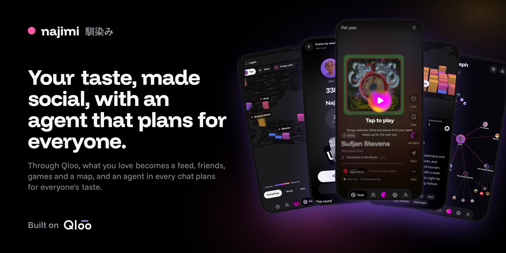
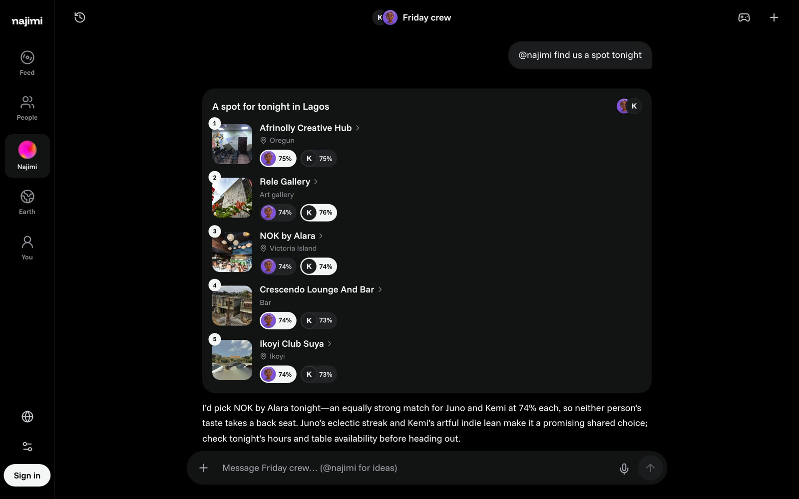
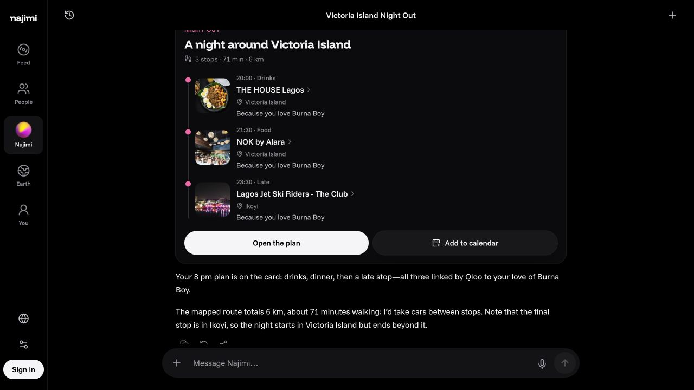
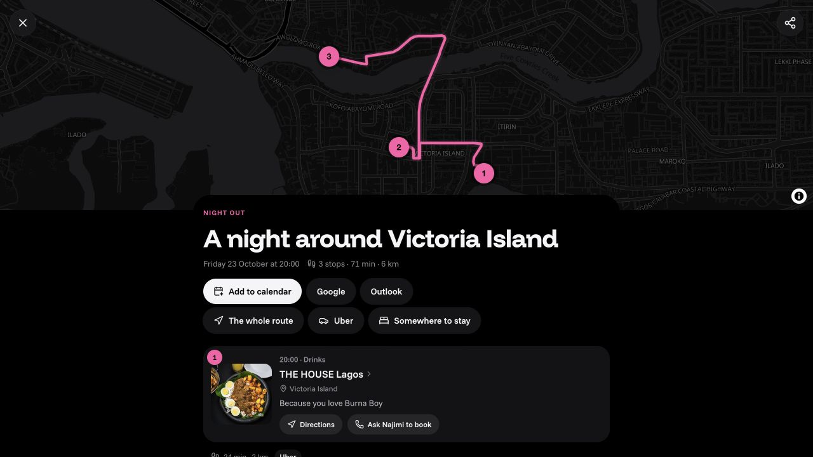
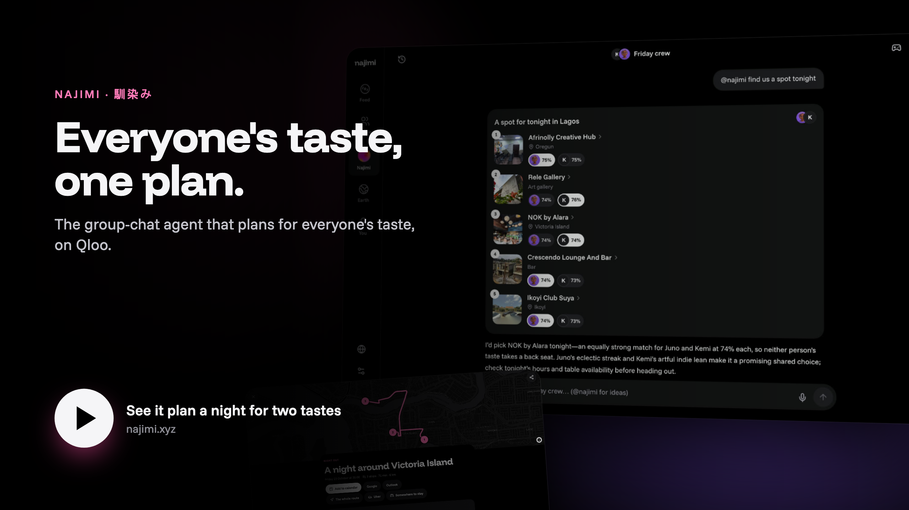
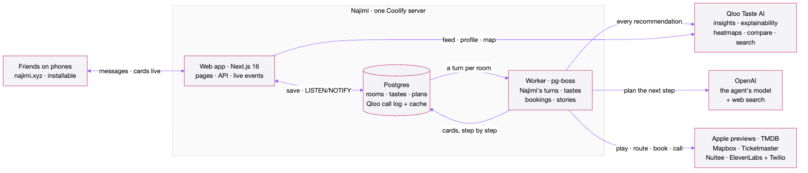
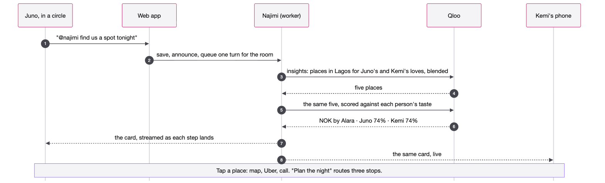

<p align="center">
  <a href="https://najimi.xyz">
    <picture>
      
    </picture>
  </a>
</p>

<h1 align="center">Najimi · 馴染み</h1>

<p align="center">
  <i>Make more of what you love.</i><br>
  <b>A living taste: things to discover, people to meet, games to play, places to go, and plans to make.</b>
</p>

<p align="center">
  <a href="https://najimi.xyz"><b>Open the app</b></a>
  &nbsp;·&nbsp;
  <a href="#try-the-demo"><b>Demo</b></a>
  &nbsp;·&nbsp;
  <a href="https://docs.najimi.xyz"><b>Docs</b></a>
  &nbsp;·&nbsp;
  <a href="https://docs.najimi.xyz/docs/qloo"><b>Every Qloo call</b></a>
</p>

<p align="center">
  Built on&nbsp;
  <a href="https://www.qloo.com">
    <picture>
      <source media="(prefers-color-scheme: dark)" srcset=".github/assets/qloo-light.svg">
      
    </picture>
  </a>
</p>

Najimi turns what you love into a living taste through **Qloo**. Start with three loves and explore a playable feed, people and circles, social games, an Earth map of local scenes, a graph of your influences, and picks that explain *why* they fit. Open a film for its trailer, an artist for their songs and shows, or a place for its map, hours and a ride. Then ask the agent to find something for you or plan with your friends. In a group chat, `@najimi` blends everyone's loves, scores candidates for each person, and plans a night that the whole room can see and act on. Every recommendation comes from Qloo, not a model's guess.

Built for the **[Qloo Agentic Hackathon](https://qloo.devpost.com/)** · [how it meets the brief](#how-najimi-meets-the-hackathon). *Najimi* (馴染み) means **someone you know well**.

## One ask, two tastes

Juno and Kemi share a circle called *Friday crew*. Juno writes one line; Najimi answers for both of them.

<p align="center">
  
</p>

1. **The ask.** "@najimi find us a spot tonight." The message is saved, announced to the room, and Najimi's turn is queued (one per room, so two asks never collide).
2. **Everyone's taste, blended.** `groupFit` gathers both members' loves, weights them so each person counts the same, and asks Qloo for places in Lagos.
3. **Each person, scored.** The same five places go back to Qloo once per member (`filter.results.entities`), so every pick carries each person's own fit:

   | Place | Area | Juno | Kemi |
   | --- | --- | ---: | ---: |
   | Afrinolly Creative Hub | Oregun | 75% | 75% |
   | Rele Gallery | Art gallery | 74% | 76% |
   | **NOK by Alara** | Victoria Island | **74%** | **74%** |
   | Crescendo Lounge And Bar | Bar | 74% | 73% |
   | Ikoyi Club Suya | Ikoyi | 74% | 73% |

4. **One pick, with the reason.** "I'd pick NOK by Alara tonight: an equally strong match for Juno and Kemi at 74% each, so neither person's taste takes a back seat." Every place on the card opens its own sheet: Directions, Uber, Call, its site and socials.
5. **The night, planned.** Asked for a night out, `planNight` puts three Qloo places in order with the real route. On najimi.xyz: *A night around Victoria Island*, THE HOUSE Lagos at 20:00, NOK by Alara at 21:30, Lagos Jet Ski Riders at 23:30, 71 minutes and 6 km between them, each "because you love Burna Boy".
6. **Booked, then followed up.** The plan page has the route, an Uber per leg, Google and Outlook calendar links, and *Ask Najimi to book*, a phone call that waits for a yes. The next morning Najimi asks how it was, and the answer steers what it suggests next.

<p align="center">
  
  
</p>

## Try the demo

<p align="center">
  <a href="https://najimi.xyz">
    
  </a>
</p>

Follow the proof on [najimi.xyz](https://najimi.xyz):

1. Start, pick three things you love, and watch Qloo build your taste live (picks in ten kinds, your taste words, where your people cluster).
2. Open **People**, start a circle with a friend (or send them its invite link), and ask "@najimi find us a spot tonight". The card shows each member's fit.
3. Tap a place: its map, Uber, phone, site and socials open in one sheet.
4. Ask "plan our night in Victoria Island at 8": three stops, routed, with *Ask Najimi to book*.
5. Tap the Qloo chip on a picks card to see the exact request behind it.

## How it works

Every chat is a room. A message is saved and announced on the room's live topic; if it calls Najimi, the worker runs the turn with Qloo as its instrument and streams each step to everyone in the room. One Postgres `LISTEN/NOTIFY` channel carries every live event to pages over server-sent events, and to phones as Web Push.

<p align="center">
  <a href="https://docs.najimi.xyz/docs/build">
    <picture>
      <source media="(prefers-color-scheme: dark)" srcset=".github/assets/system-dark.png">
      
    </picture>
  </a>
</p>

<p align="center">
  <a href="https://docs.najimi.xyz/docs/agent">
    <picture>
      <source media="(prefers-color-scheme: dark)" srcset=".github/assets/group-turn-dark.png">
      
    </picture>
  </a>
</p>

<p align="center"><a href="https://docs.najimi.xyz/docs/build">Open the detailed map</a> · <a href=".github/diagrams">Edit the Mermaid source</a></p>

**The agent.** Najimi runs on the AI SDK's tool loop (up to ten steps a turn) with Qloo's whole surface as tools, `qlooSearch`, `qlooInsights`, `qlooTags`, `qlooCompare` and `qlooAudiences`, beside `groupFit`, `planNight`, `planTrip`, `startPoll`, `startGame`, `steerFeed`, `findHotels`, `callToBook`, `businessPlan`, `postToX`, `makeImage`, `tasteBrief`, `askUser`, and hosted web search for facts Qloo doesn't carry. Its first rule is *Qloo or nothing*: every recommendation comes from a Qloo result in that chat. Anything that acts in someone's name (a call, a post, a booking) waits for that person's yes, and only the person who asked can give it.

### Built on Qloo

| Qloo | What it does in Najimi | Where in the code |
| --- | --- | --- |
| `POST /v2/insights`, weighted loves, explainability | Each person's picks in ten kinds; the *because* chip and *Made of your loves*; the feed's next pages | [`packages/qloo/src/taste.ts`](packages/qloo/src/taste.ts) `profilePicks` |
| Blended signals + `filter.results.entities` | A circle's taste (each member counts the same), then every candidate scored per person; game answers | [`taste.ts`](packages/qloo/src/taste.ts) `blendLoves`, [`agent/src/server/tools.ts`](packages/agent/src/server/tools.ts) `groupFit` |
| `urn:tag` insights | Each person's taste words | [`taste.ts`](packages/qloo/src/taste.ts) `profileWords` |
| `urn:heatmap` | The Earth globe, a trip's areas, where a business's people cluster | [`packages/qloo/src/explore.ts`](packages/qloo/src/explore.ts) `explore`, `nameAreas` |
| `signal.location` with no person | A square's scene: its artists, brands, places, words | [`explore.ts`](packages/qloo/src/explore.ts) `sceneOf` |
| `/v2/analysis/compare` | Your match with anyone; a business against its street | [`packages/qloo/src/api.ts`](packages/qloo/src/api.ts) `compare` |
| `/search`, `/entities`, `/v2/tags`, `/v2/audiences` | Names to ids, imports by handle, a thing's full record (place hours, IMDb, socials), tags by meaning | [`api.ts`](packages/qloo/src/api.ts) |

Every call goes through one client with a concurrency limit, retries, a Postgres cache keyed by path, parameters and body, and a call log; the Qloo chip on a picks card opens the exact request behind it. [The full map is in the docs](https://docs.najimi.xyz/docs/qloo).

## How Najimi meets the hackathon

The brief, *Agents, but with taste*: a working application that integrates Qloo's API as an agentic tool, an application built with an agent framework, or an integration into an existing agent, where cultural intelligence materially changes the result compared with an LLM alone. Najimi is the second form: an agent built on the AI SDK, with Qloo as its instrument.

| Requirement or criterion (verbatim) | How Najimi meets it | Where to check |
| --- | --- | --- |
| Stage one: viable theme fit | An agent that lives in group chats and plans for the people in them; Qloo decides every pick | [The journey above](#one-ask-two-tastes); [`packages/agent/src/instructions.ts`](packages/agent/src/instructions.ts) rule 1 |
| Stage one: reasonable application of the required APIs | Insights, explainability, heatmaps, location signals, per-entity scoring, compare, search, entities, tags and audiences, all live | [Built on Qloo](#built-on-qloo); [`packages/qloo/src`](packages/qloo/src) |
| **Technological Implementation** | Rooms on Postgres with one turn per room in a pg-boss worker, every step streamed to every member over server-sent events; a cached, rate-limited, logged Qloo client; approvals bound to the asker | [`packages/agent/src/server/turn.ts`](packages/agent/src/server/turn.ts), [`packages/live`](packages/live), [`packages/qloo/src/client.ts`](packages/qloo/src/client.ts) |
| **Design** | One coherent app: a sheet that opens any thing the same way everywhere, cards that play and route in place, stories, a feed, a globe | [najimi.xyz](https://najimi.xyz); [the docs' guide](https://docs.najimi.xyz/docs/guide) |
| **Potential Impact** | The group chat is where friends already decide where to go and what to watch; Najimi answers there, for everyone at once, and books | [Plans and booking](https://docs.najimi.xyz/docs/guide/plans) |
| **Quality of the Idea** | Qloo scores each pick for each person, so the room sees whose taste it fits and why, instead of one person's feed or a model's guess | [`groupFit`](packages/agent/src/server/tools.ts); the card in the capture above |

## Proof and evidence

- **The Qloo call log, live.** Production had logged 805 Qloo calls by 23 October 2026: 443 insights, 344 searches, 15 entity lookups, 2 tag searches and 1 compare. A picks card's Qloo chip opens its own call.
- **The run above.** The Friday crew card is a stored `groupFit` result from a local run with two test members (the tool part and its Qloo call id are kept in the room's messages), not a mock-up.
- **Plans on najimi.xyz.** *A night around Victoria Island* was planned and routed on the live site; its page carries the route, Uber links, calendar files and *Ask Najimi to book*.

### The rest of Najimi

- **Your taste in a minute:** pick three loves, or bring a Letterboxd, Last.fm or Goodreads name, or X and Instagram handles. [Quickstart](https://docs.najimi.xyz/docs/guide/quickstart)
- **One sheet for any thing:** a film's trailer and where to watch it, an artist's songs, music videos and next concerts, a place's map, phone and socials, what people say on TikTok, YouTube and X. [Profile](https://docs.najimi.xyz/docs/guide/profile)
- **Feed:** full-screen cards with Apple previews, trailers, podcast episodes and places, tuned like a mixing desk, one player across the app. [Feed](https://docs.najimi.xyz/docs/guide/feed)
- **Circles and chats:** polls, the circle's soundtrack, QR invites, games with a daily drop and a weekly board. [Chats](https://docs.najimi.xyz/docs/guide/chats) · [Games](https://docs.najimi.xyz/docs/guide/games)
- **Stories:** a photo, a video, a song, a pick or a plan for a day; replies land in your DMs. [People](https://docs.najimi.xyz/docs/guide/people)
- **Earth and the graph:** where your taste lives, square by square; your taste as a web you can pull. [Earth](https://docs.najimi.xyz/docs/guide/earth) · [Graph](https://docs.najimi.xyz/docs/guide/graph)
- **Business mode:** "I run a café in Yaba" becomes a plan you can share, rebuilt every Monday. [Business](https://docs.najimi.xyz/docs/guide/business)
- **Passport and Wrapped:** the year at a glance, five slides to share to Instagram Stories. [Passport](https://docs.najimi.xyz/docs/guide/passport)
- **Your feeds:** a score for how much of your For You page is you, and accounts to follow from your taste. [Your feeds](https://docs.najimi.xyz/docs/guide/feeds)

## Run it locally

You need Node 22.18 or later, pnpm 11 and Docker.

```bash
cp .env.example .env    # QLOO_API_KEY and OPENAI_API_KEY at least
pnpm install
pnpm services:up        # Postgres and RustFS
pnpm dev                # web on :3310, docs on :3311, the worker (migrates on start)
```

`pnpm run ci` runs the linter, type checks and production builds.

## Repository layout

A pnpm and Turborepo monorepo; every piece runs as a container on one Coolify server.

| Path | What |
| --- | --- |
| [`apps/web`](apps/web) | Next.js 16: pages, API routes, cards, the landing, link previews and story slides |
| [`apps/worker`](apps/worker) | pg-boss: Najimi's turns, taste reveals, business plans, bookings and follow-ups, video stories, push; runs migrations |
| [`apps/docs`](apps/docs) | The documentation (Fumadocs) |
| [`apps/social-bridge`](apps/social-bridge) | Python FastAPI, internal only: Instagram |
| [`packages/qloo`](packages/qloo) | The Qloo client: cache, concurrency limit, retries, call log, taste and explore helpers |
| [`packages/agent`](packages/agent) | Rules, tools, turns, polls, business plans |
| [`packages/booking`](packages/booking) | Plans, routes, shows, tour dates, hotels, phone calls, calendar files |
| [`packages/connectors`](packages/connectors) | Imports, the daily tune-up, X, sealed sessions |
| [`packages/sources`](packages/sources) | Media and links outside Qloo: Apple previews, trailers, where to watch, a site's socials |
| [`packages/db`](packages/db), [`live`](packages/live), [`jobs`](packages/jobs), [`games`](packages/games), [`geo`](packages/geo) | Drizzle schema and migrations; the live pipe; queues; rounds and scoring; geohash squares |

## Credits

- **Qloo** data comes from the hackathon API; entity artwork is Qloo's, and the Qloo wordmark is used to credit it. No Qloo data is stored in this repository.
- **Music previews** are Apple's (30 seconds, each linking to Apple Music); **trailers and where to watch** come from TMDB (where-to-watch data by JustWatch); **podcasts** play from each show's own feed; **book covers** from Open Library; **shows and tour dates** from Ticketmaster.
- **Places and routes:** OpenStreetMap (© OpenStreetMap contributors) through Nominatim, Mapbox Directions, MapLibre GL JS.
- Third-party code and asset licences are listed in [`THIRD_PARTY_NOTICES.md`](THIRD_PARTY_NOTICES.md).

## Honest limits

- The circles in the captures are test members; Najimi has had no outside testers yet.
- Hotel booking runs through Nuitee's live key, which isn't set on najimi.xyz yet, so hotels say they aren't switched on there. Table calls are configured (an ElevenLabs voice agent over Twilio) but haven't rung a real venue yet; from Nigeria they show a US number.
- Acting on X and Instagram for you needs your own signed-in session, which those platforms can lock; reading your taste never does.
- The interface is in English; eleven other languages fall back to English where they're incomplete.

## License

[MIT](LICENSE).
