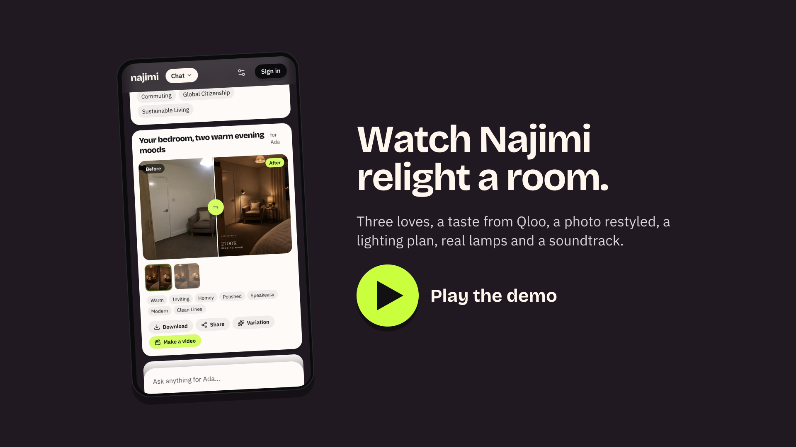

<p align="center">
  <a href="https://najimi.84.46.247.92.sslip.io">
    
  </a>
</p>

<h1 align="center">Najimi · 馴染み</h1>
<p align="center">The taste copilot.<br/>Tell it three things you love. It reads your taste through Qloo, then makes things for your real life that fit you.</p>

<p align="center">
  <a href="https://najimi.84.46.247.92.sslip.io"><b>Open Najimi</b></a>
  &nbsp;·&nbsp;
  <a href="https://najimi.84.46.247.92.sslip.io/demo"><b>Demo</b></a>
  &nbsp;·&nbsp;
  <a href="https://najimi-docs.84.46.247.92.sslip.io"><b>Documentation</b></a>
  &nbsp;·&nbsp;
  <a href="https://najimi-docs.84.46.247.92.sslip.io/qloo"><b>How it uses Qloo</b></a>
  &nbsp;·&nbsp;
  <a href="https://najimi.84.46.247.92.sslip.io/workflows"><b>Workflows</b></a>
</p>

**Najimi is an agent that knows what people love and makes things for their lives.** You give it a book, an artist and a show. [Qloo](https://www.qloo.com)'s taste graph turns those into the words your taste is made of (minimalist, warm, speakeasy, Caribbean) and picks across ten domains, each with the reason. Then you ask for something real: relight your room, cook for your mum, find your next book. Najimi restyles your own photo, writes a lighting plan an electrician can install, finds real lamps from brands that fit you, or cooks at the texture your grandmother needs. Every answer shows the Qloo data behind it.

Built for the **[Qloo Agentic Hackathon](https://qloo.devpost.com/)**. *Najimi* (馴染み) means **familiar**: the one who knows you.

## The problem

Recommendations stop at a list. A list of "lamps you might like" doesn't relight your room, and "restaurants for you" doesn't cook dinner for a parent on warfarin who needs soft food served lukewarm. General chat assistants can do the making, but they don't know your taste: ask two people's assistants to restyle the same room and you get the same beige room twice.

Najimi joins the two. Qloo knows what you'd love across music, film, books, places and brands; the agent turns that into things you can use, made from your taste's own words, for you or for anyone you look after.

## A first visit

1. **Start** asks your name and three things you love: say *Insecure*, Burna Boy and *Americanah*. Qloo artwork appears as you search. Say how much each counts.
2. **The reveal** happens live: your words land first (Look: Minimalist, Clean Lines; Rooms: Homey, Speakeasy; Food: Caribbean, Comfort Food), then picks in ten domains, each with a **because** chip ("because you love Insecure").
3. **Relight my room.** Pick a sample bedroom (or your own photo), say it's for reading and slow evenings. Najimi restyles *that* room in two warm moods, keeping every wall and chair, and writes a plan: layers, fixtures, 2700 K at 75 % for reading, a note for the electrician. It asks Qloo for lighting brands that match your taste, reads real floor lamps and prices from their own sites, and picks a soundtrack.
4. **Share it.** The link unfurls with the result in any chat app. Your own photo is never shown.

About three minutes on a phone, with no account. Signing in later keeps everything.

## Demo

<p align="center">
  <a href="https://najimi.84.46.247.92.sslip.io/demo">
    
  </a>
</p>

The recorded walkthrough is on its way. Until it's published, [najimi…/demo](https://najimi.84.46.247.92.sslip.io/demo) says so and walks you through the same path on the live app.

## How Najimi uses Qloo

The agent gets Qloo's whole surface as tools, not a single "recommend" button, and composes them per ask.

| Tool | Qloo endpoint | Used for |
| --- | --- | --- |
| `qlooSearch` | `/search` | Turning a name ("Fela", "Kyoto") into an id to use as a signal or filter |
| `qlooTags` | `/v2/tags` | Moods, genres, cuisines, decor and place kinds by meaning |
| `qlooInsights` | `/v2/insights` | Picks of any type, a taste's words, a city **heatmap**, the **demographic** lean, with every documented signal and filter |
| `qlooCompare` | `/v2/analysis/compare` | Two tastes side by side (you and Mum, *Fleabag* vs *Insecure*) |
| `qlooAudiences` | `/v2/audiences` | Audiences to lean a taste with (never political ones) |

"70s films I'd love" becomes `releaseYear 1970–1979`; "hidden gems" becomes `popularity ≤ 0.3`; "where would I hang out in Paris" becomes a heatmap with named areas; "dinner for Mum" adds `age 55_and_older` and her city. Your loves go in as weighted signals (`{ id, weight }`), and Qloo's explainability names the love behind each result.

You can check it: every Qloo card has a **Qloo** chip that opens the exact request, every taste page lists the calls behind it (**Built on Qloo**), and **Compare without taste** answers the same ask without Qloo, side by side. More in the [Qloo page of the docs](https://najimi-docs.84.46.247.92.sslip.io/qloo).

## What it makes, and with what

| Capability | How |
| --- | --- |
| Chat agent | AI SDK 7 with OpenAI; up to 10 tool steps per turn; approvals for anything that costs |
| Restyles and new images | OpenAI image models; your photo is kept private, results get thumb and display renditions |
| Short films | fal image-to-video (FLUX 3 Max, then Kling 3.0 from 7 November) through a queue and a poller; **built, switched off until a `FAL_KEY` is set** |
| Lighting plans, recipes, meal plans | Structured tools: kelvin, lumens, layers, an electrician's brief; IDDSI texture levels, serving temperature |
| Real products | Brands from Qloo; product pages read from each brand's own site (JSON-LD), only items with a price |
| Medication notes | The FDA label via openFDA (interactions such as vitamin K with warfarin) |
| Voice | ElevenLabs Scribe: tap, talk, edit, send |
| Workflows | Seven built-in recipes, plus your own saved from a chat and shareable at `/w/<name>` |
| Languages | English, French, Spanish, Portuguese, Arabic (right to left); Yoruba, Hausa, Igbo, Swahili, Hindi, Chinese and Japanese in beta |

## What is verified, and the limits

Checked on 21 October 2026.

On the live app:

- A new guest's taste reveal (all ten domains) in about 4 seconds; composed asks (70s films, hidden gems, a Paris heatmap with three named areas).
- Sample rooms restyled in two variants in about 20 seconds; a bedroom relit with a lighting plan, Qloo lighting brands and a product search in one turn (the showcase on the landing page comes from these runs).
- Link previews for workflow links; email sign-in codes.

On a local copy of the same code:

- The Relight my room workflow end to end, including real lamps with prices; Cook for… in French with FDA notes and an IDDSI level 5 recipe.
- Chat shares with the owner's photo removed from the page (and a 404 for it even with the share token); a saved workflow running from its link.
- Every public page in all twelve languages with the right direction; "delete all my data" removing the rows and the stored files.

Limits, plainly:

- **Video is off** until a fal.ai key is set; Najimi doesn't offer it until then.
- The beta languages are machine-translated (checked for structure, not by native speakers).
- Product search reads brands' own sites, so a brand without product pages, or without prices, shows none.
- Medication notes quote the label; they are not medical advice.
- Guests nobody has used for 30 days are deleted, with everything they made.
- The sslip.io address is a temporary domain for the hackathon.

## Architecture

A pnpm and Turborepo monorepo: a Next.js 16 web app, a pg-boss worker, Postgres 17, RustFS (S3) for media, and a Fumadocs site, each a container on Coolify. Live updates go from the worker through Postgres `LISTEN/NOTIFY` to pages as server-sent events. The [architecture page](https://najimi-docs.84.46.247.92.sslip.io/architecture) has the diagrams.

| Path | What |
| --- | --- |
| [`apps/web`](apps/web) | Pages, API routes, the chat route, cards, link previews |
| [`apps/worker`](apps/worker) | Taste reveal, image and video jobs, titles, the nightly guest sweep; runs migrations |
| [`apps/docs`](apps/docs) | The documentation site |
| [`packages/agent`](packages/agent) | Model registry, tools, rules, workflows |
| [`packages/qloo`](packages/qloo) | Qloo client: caching, de-duplication, call log, taste helpers |
| [`packages/db`](packages/db) | Drizzle schema and migrations; moving a guest's data on sign-in; deleting a person's data |
| [`packages/media`](packages/media), [`sources`](packages/sources), [`storage`](packages/storage) | Image and video providers; openFDA and brand pages; S3 and signed media links |
| [`packages/config`](packages/config), [`env`](packages/env), [`jobs`](packages/jobs), [`live`](packages/live), [`email`](packages/email), [`tokens`](packages/tokens), [`ui`](packages/ui) | Every tunable, typed env, queues, live events, email codes, design tokens, components |

## Run it locally

You need Node 22.18 or later (24 is used), pnpm 11 and Docker.

```bash
cp .env.example .env    # fill in QLOO_API_KEY and OPENAI_API_KEY at least
pnpm install
pnpm services:up        # Postgres and RustFS
pnpm dev                # web on :3310, docs on :3311, the worker (migrates on start)
```

`pnpm run ci` runs the linter, type checks and production builds. `pnpm --filter @najimi/web i18n:translate es pt …` fills any catalog strings that are missing or whose English changed.

## Provenance

- **Qloo** data comes from the hackathon API (`hackathon.api.qloo.com`). Entity artwork is Qloo's.
- **Map tiles** © OpenStreetMap contributors.
- **Fonts:** Bricolage Grotesque, IBM Plex Sans and IBM Plex Sans Arabic (SIL Open Font License), plus a three-character subset of Noto Sans JP for 馴染み in the banner.
- **Sample rooms** in [`apps/worker/samples`](apps/worker/samples) were generated for this project with an image model; they show no real home.
- **Showcase images** on the landing page were made by Najimi from those sample rooms by a demo account, and marked public by hand.
- **README art** ([`banner`](.github/assets/banner.png), [`demo cover`](apps/web/public/demo/cover.png)) is drawn by [`scripts/readme-art`](apps/web/scripts/readme-art/make.tsx) from phone captures of the live app in [`.github/assets/captures`](.github/assets/captures).
- Written by Abu with Claude Code.

## License

[MIT](LICENSE).
